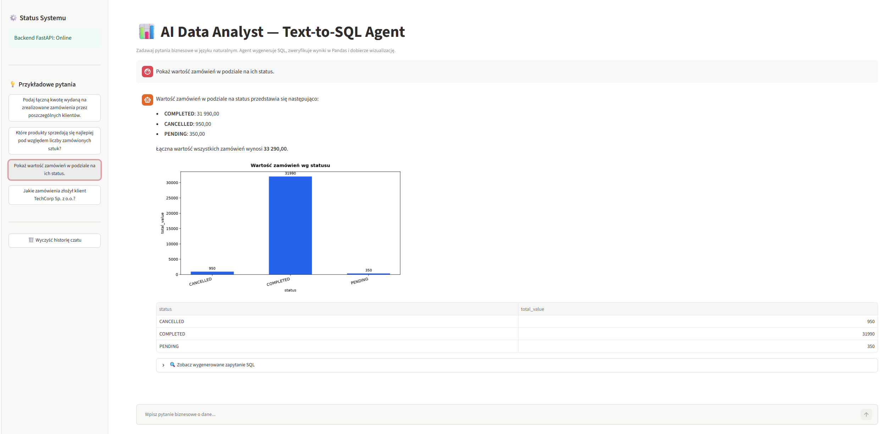

# Text-to-SQL AI Data Analyst Agent 📊🤖

Kompleksowy system analityczny oparty o architekturę klient–serwer. Aplikacja przekształca pytania biznesowe zadawane w języku naturalnym na bezpieczne zapytania SQL, weryfikuje obliczenia w **Pandas**, automatycznie dobiera i generuje wykresy w **Matplotlib**, a całość prezentuje w interaktywnym interfejsie **Streamlit** połączonym z REST API (**FastAPI**).



## 🌟 Kluczowe Funkcjonalności

- **Dynamic Schema Inspection & Sampling:** Agent pobiera strukturę tabel (`sqlite_master`) wraz z przykładowymi wierszami danych, eliminując błędy wielkości liter i formatowania.
- **Self-Correction Loop (Pętla Autokorekty):** W przypadku błędu wykonania zapytania w SQLite, agent przechwytuje komunikat błędu i autonomicznie poprawia kod SQL (do 3 prób).
- **Deterministic Math (Pandas):** Wszystkie sumy i statystyki są wyliczane deterministycznie przez bibliotekę Pandas przed przekazaniem ich do modelu LLM, co całkowicie eliminuje halucynacje matematyczne.
- **Automated Data Visualization (LLM Router + Matplotlib):** Agent ocenia strukturę wyników i automatycznie generuje wykresy (`bar`, `line`, `pie`) serwowane przez dedykowany endpoint API.
- **Read-Only Safety Guardrail:** Warstwa walidacji blokująca jakiekolwiek operacje modyfikujące bazę (dozwolone wyłącznie zapytania `SELECT`).

## 🛠️ Stack Technologiczny

- **Backend API:** FastAPI, Uvicorn, Pydantic
- **Frontend UI:** Streamlit
- **Data Processing & Charts:** Pandas, Matplotlib
- **Database:** SQLite
- **LLM Engine:** Groq API (`qwen/qwen3.8-27b`)

## 🚀 Uruchomienie Projektu

### 1. Klonowanie repozytorium i instalacja zależności
```bash
git clone [https://github.com/fudiaszek-ai/text-to-sql-agent.git](https://github.com/fudiaszek-ai/text-to-sql-agent.git)
cd text-to-sql-agent
python -m venv venv
.\venv\Scripts\activate
pip install -r requirements.txt
```

### 2. Konfiguracja klucza API
Stwórz plik `.env` w głównym katalogu projektu:
```env
GROQ_API_KEY=twój_klucz_groq_api
```

### 3. Uruchomienie Backendu (Terminal 1)
```powershell
uvicorn api:app --reload
```
Dokumentacja Swagger UI dostępna pod adresem: `http://127.0.0.1:8000/docs`

### 4. Uruchomienie Interfejsu Użytkownika (Terminal 2)
```powershell
streamlit run app.py
```
Aplikacja otworzy się w przeglądarce pod adresem: `http://localhost:8501`